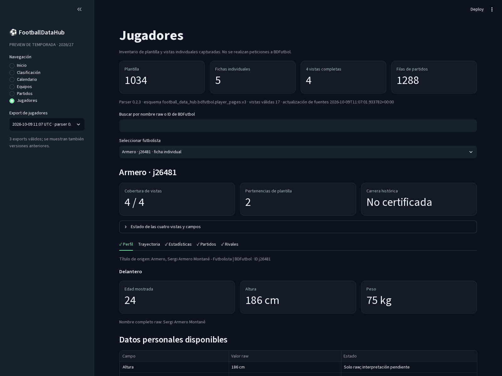
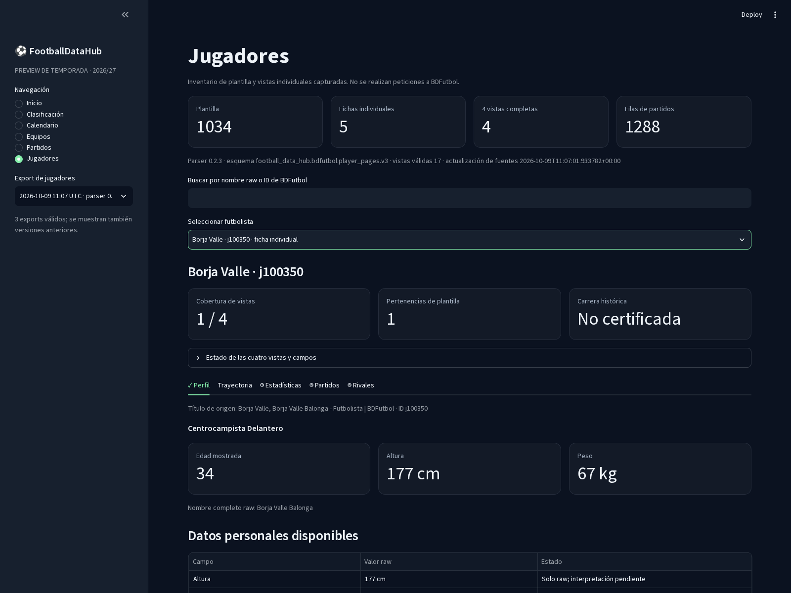
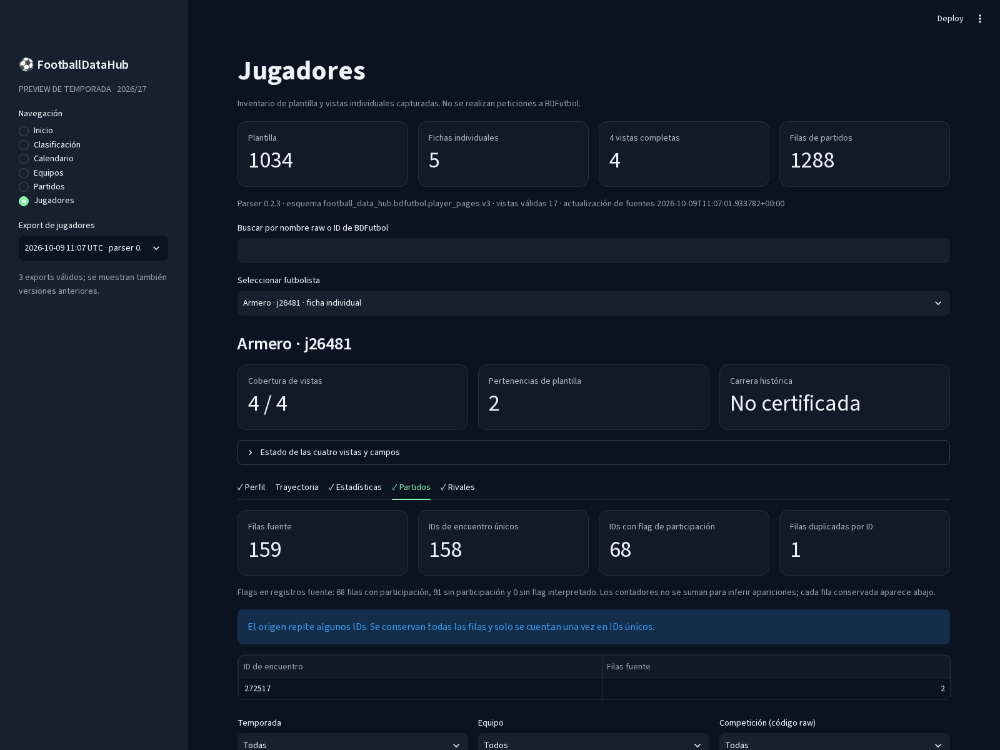

# Preview deportiva local

La preview es una aplicación Streamlit local, deportiva y de solo lectura para los exports parsed de Primera Federación 2026/27 y de jugadores. Lee exclusivamente los exports JSON/CSV gzip ya creados; no visita BDFutbol, no inicia scrapers y no modifica snapshots ni exports.

## Instalación y ejecución

Desde la raíz del repositorio, instala las dependencias opcionales y arranca la aplicación:

```bash
.venv/bin/python -m pip install -e '.[dev-explorer]'
.venv/bin/streamlit run scripts/run_dev_explorer.py
```

Abre <http://127.0.0.1:8502>. Streamlit queda ligado a `127.0.0.1` y sus métricas de uso están desactivadas. Detén el servidor con `Ctrl+C`.

## Navegación

- **Inicio:** cifras del grupo elegido, resultados recientes, próximos encuentros y cinco primeros puestos.
- **Clasificación:** tabla completa con estadísticas de posición, puntos, partidos, goles y tarjetas; incluye un resumen del equipo seleccionado.
- **Calendario:** filtro por grupo y jornada, estado en español, fecha, marcador y campos de estadio y árbitro cuando existen.
- **Equipos:** posición, estadísticas y los últimos resultados y próximos partidos del equipo seleccionado.
- **Partidos:** ficha deportiva con equipos, marcador, jornada, fecha, estado, estadio, árbitro y enlace de origen cuando está publicado.
- **Jugadores:** búsqueda por nombre raw o ID en el inventario de 1.034 jugadores. La etiqueta distingue las fichas individuales de los jugadores que solo aparecen en plantillas. Para las fichas disponibles muestra datos personales, pertenencias, referencias de fotografías, trayectoria raw, estadísticas, encuentros de `window.P` y relaciones de rivales. Cada vista indica si está capturada o pendiente.
- **Calidad y procedencia:** acceso secundario desde el final de la barra lateral. Conserva los checks del parser, los diagnósticos, los registros sin ID, la validez de acceso, las URLs de origen y el hash del snapshot.

El selector de competición detecta los exports, permite elegir una captura anterior y selecciona por defecto la captura válida más reciente según sus metadatos. Jugadores tiene su selector independiente para los exports bajo `data/parsed/bdfutbol/player_2026_27/compact/`: elige por defecto el export compatible más reciente y permite volver a otros exports compatibles. Se valida el esquema v3 del parser; exports de esquemas anteriores se dejan fuera para evitar mezclar contratos incompatibles.

Los encuentros muestran por separado las filas fuente, los IDs de partido únicos y los IDs que tienen flags de participación. La tabla mantiene todas las filas repetidas del origen; una repetición de ID no se presenta como otro encuentro único. Temporada, equipo y código de competición son filtros locales. Las estadísticas, las celdas raw y los agregados se muestran como se conservaron, sin convertir agregados en partidos.

Los estados distinguen vistas pendientes de adquisición, campos que no aparecen en un snapshot y valores conservados solo como raw. La aplicación no certifica que una trayectoria sea históricamente completa. Las referencias a fotografías y URLs de partidos se muestran como texto; la preview no descarga imágenes ni solicita recursos a BDFutbol.

## Limitaciones

Las fichas individuales cubren solo los cinco jugadores presentes en el export actual y no equivalen a cobertura de los 1.034 jugadores. Borja Valle solo tiene perfil: sus estadísticas, partidos y rivales se indican como pendientes, sin rellenarlos desde los agregados de otros jugadores. La vista de partidos depende de las filas `individual_matches` creadas desde `window.P`; los flags describen lo que publica la fuente y no se reinterpretan como minutos o titularidades si esos valores no están disponibles. Valores sin semántica confirmada se presentan como raw.

En exports antiguos de competición sin `fixture_status`, la capa de presentación deriva estados a partir de `result_status`, fecha y captura; no reescribe el dataset.

Capturas locales de la preview:






