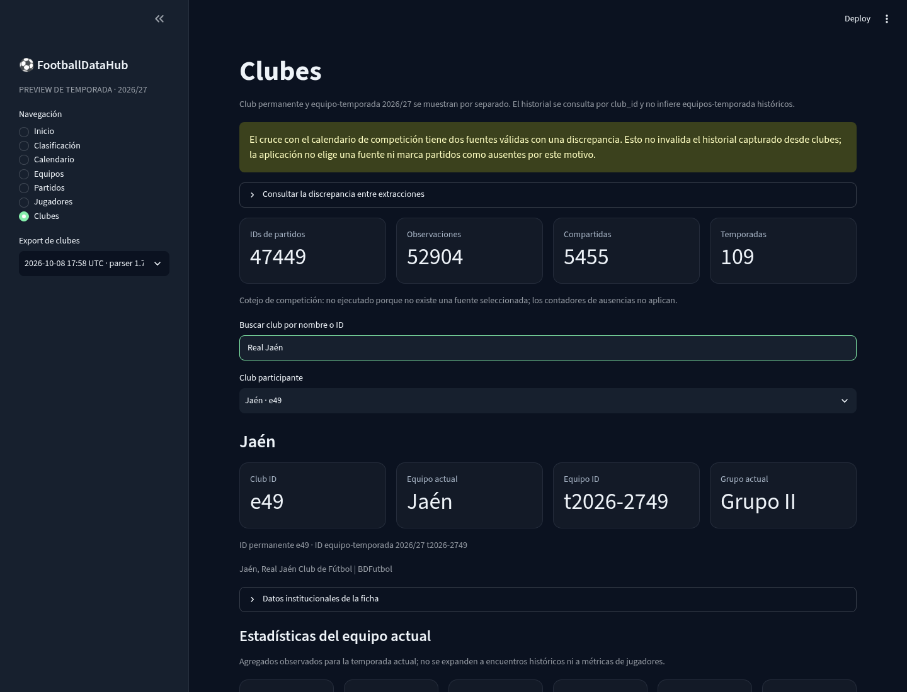
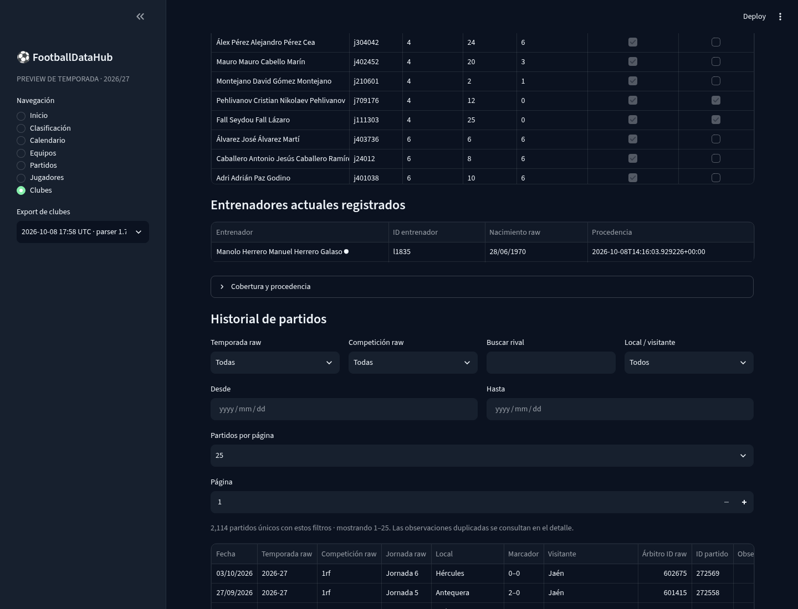
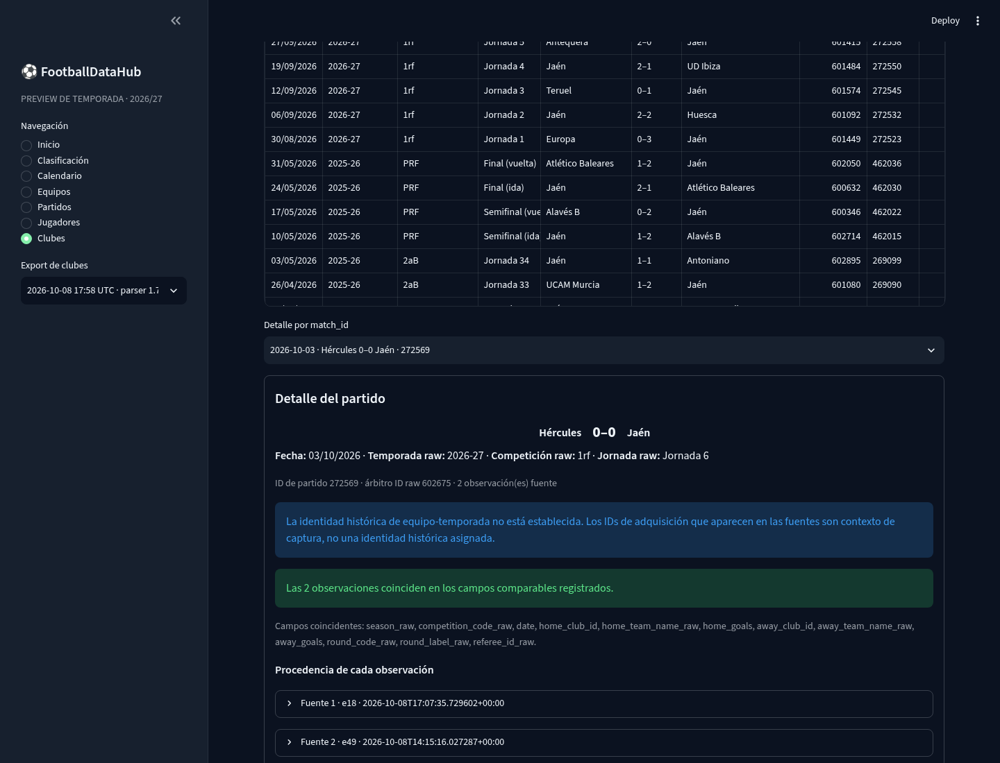
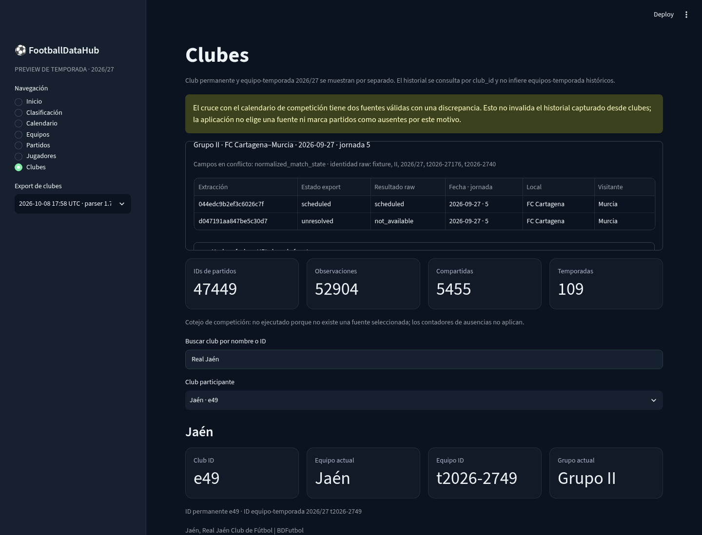

# Hito 1D-C3 — Historial de clubes y partidos en Dev Explorer

## Resultado

Se añadió **Clubes** a la preview Streamlit como una vista offline y de solo lectura. Reutiliza los exports compactos existentes de clubes/equipos y competición. No visita BDFutbol, no ejecuta adquisición y no modifica parsers, snapshots ni exports deportivos.

La vista presenta el inventario de clubes, la identidad permanente `club_id`, el equipo-temporada actual, el grupo cuando existe consenso entre exports válidos, los datos institucionales capturados, la plantilla y el cuerpo técnico actuales, estadísticas del equipo y procedencia/cobertura. La sección es independiente del selector de grupo de la preview de competición y conserva las demás pantallas.

## Fuentes locales y alcance comprobado

El export seleccionado automáticamente es `data/parsed/bdfutbol/club_team_2026_27/compact/snapshot-7ffcbd5f11c8e83fdae4-parser-1.7.0/`. Es parser 1.7.0, export `football_data_hub.bdfutbol.club_team_export.v2` y deportes v3. Se validan los JSON gzip requeridos y su compatibilidad antes de habilitar la vista; se pueden seleccionar otras versiones compatibles. Las fichas de club se cargan únicamente desde archivos locales.

El export contiene 40 clubes, 47.449 IDs de partido únicos, 52.904 observaciones fuente, 5.455 observaciones compartidas entre clubes y 109 temporadas raw. Todas las filas de partido tienen ID y los equipos local/visitante enlazan a IDs permanentes de club. La página busca y pagina en memoria; no consulta archivos raw HTML ni recursos remotos.

Para el ejemplo local de Jaén, la búsqueda «Real Jaén» encuentra el registro de club `e49`, cuyo nombre deportivo capturado es «Jaén». Se presenta por separado el equipo-temporada actual `t2026-2749`, asignado al Grupo II por consenso de los exports de competición. Su historial contiene 2.114 IDs de partido a través de 70 temporadas observadas. El export registra 25 pertenencias de plantilla, un entrenador y agregados actuales PJ 6, PG 3, PE 2, PP 1, GF 8 y GC 5. Esos datos describen lo que conserva el export, no certifican una carrera completa ni la cobertura total de la fuente.

## Historial y procedencia

La búsqueda del historial se hace por `club_id`. Se añadieron filtros locales por temporada raw, código de competición raw, rival, local/visitante y fechas desde/hasta, además de paginación de 25, 50 o 100 partidos. La tabla muestra fecha, temporada, competición, jornada, nombres de ambos lados, marcador, árbitro raw, `match_id` y cantidad de observaciones. La selección del detalle usa `match_id`, no una posición de fila.

El detalle conserva cada observación fuente asociada al partido, con club y equipo-temporada de captura como contexto, URL, índice de fila, hora UTC, SHA-256, celdas raw y mapa de campos cuando existe. Compara campos homólogos y destaca diferencias. Las observaciones compartidas siguen visibles por separado; una repetición en la fuente no se convierte en otro partido.

Los partidos históricos no reciben una identidad `team_season_id` inferida. El identificador de equipo-temporada que pueda aparecer en una observación se etiqueta solo como contexto de adquisición.

## Ambigüedad de fuentes de competición

La metadata local declara `AMBIGUOUS_VALID_SOURCES`. La discrepancia visible de ejemplo corresponde al fixture FC Cartagena–Murcia, Grupo II, 27/09/2026, jornada 5. Una extracción conserva estado `scheduled` y la otra `unresolved`/`not_available`; el informe en la interfaz presenta ambos estados raw y el panel secundario muestra fecha de captura, hash y URL de cada fuente cuando están disponibles.

No se selecciona automáticamente un export ni se usa esa comparación para declarar ausencias en el historial de clubes. El cruce sigue como `NOT_RUN_NO_SELECTED_COMPETITION_SOURCE`; los contadores nulos no se convierten en ceros. La discrepancia no invalida los datos de historial obtenidos desde los clubes.

## Implementación

- `src/football_data_hub/dev_explorer/data.py`: descubrimiento/versionado de exports de clubes; validación streaming de gzip JSON; carga de fichas locales; proyección de campos de presentación para limitar memoria; índices por club y partido; consenso de grupo; filtros; búsqueda de evidencia de conflictos y comparación de observaciones.
- `src/football_data_hub/dev_explorer/app.py`: sección Clubes, perfil, plantilla, entrenador, estadísticas actuales, filtros/paginación del historial, detalle y evidencia de discrepancias. La tabla de valores raw serializa cada celda como JSON para mantener vacíos, números, strings y tipos mixtos sin forzar conversiones de Streamlit.
- `tests/test_dev_explorer_data.py`: pruebas de compatibilidad/versionado, gzip inválido, búsqueda, filtros, observaciones únicas/compartidas, identidad histórica ausente, ambigüedad, estados de cotejo, perfil parcial, consenso y fixture de club disponible en el repositorio.
- `tests/test_dev_explorer_app.py`: navegación AppTest a Clubes.
- `docs/dev_explorer.md`: instrucciones, alcance y límites de las pantallas.

La lectura del export usa streaming de las listas grandes y conserva solo los campos necesarios para esta pantalla en los índices de partidos y observaciones. En una medición local con Python 3.14.7, descubrir 18 versiones compatibles/incompatibles tomó 6,383 s y la carga del export actual tomó 3,415 s; el RSS del proceso pasó de 30,3 MiB tras descubrir a 557,2 MiB tras la carga. Estos valores dependen de máquina/cache y sirven como línea base, no como promesa de rendimiento.

## Verificación visual

La aplicación se ejecutó localmente en `127.0.0.1:8502`; las capturas se guardaron en `docs/assets/`. El ejemplo usa datos ya presentes y no se generaron clubes, fotografías, marcadores ni estadísticas. La captura de discrepancia muestra explícitamente los dos estados candidatos, sin elegir fuente.

## Validación y límites

La suite completa se ejecutó con `PYTHONPATH=src .venv/bin/python -m pytest -q`: **270 passed in 53,05 s**. El test preexistente de puerto loopback requirió permitir un socket local. Ruff terminó con `All checks passed!` para los cuatro módulos Python modificados y `git diff --check` terminó limpio.

La vista solo presenta la cobertura contenida en los exports compatibles. Las plantillas y entrenadores corresponden al equipo actual de 2026/27, no a temporadas históricas. Los nombres, códigos, celdas raw, árbitros y estadísticas no se enriquecen con consultas externas ni se les asigna semántica que el export no confirme. La aplicación no certifica que BDFutbol publique o que el scraper haya adquirido todo el historial de cada club.
