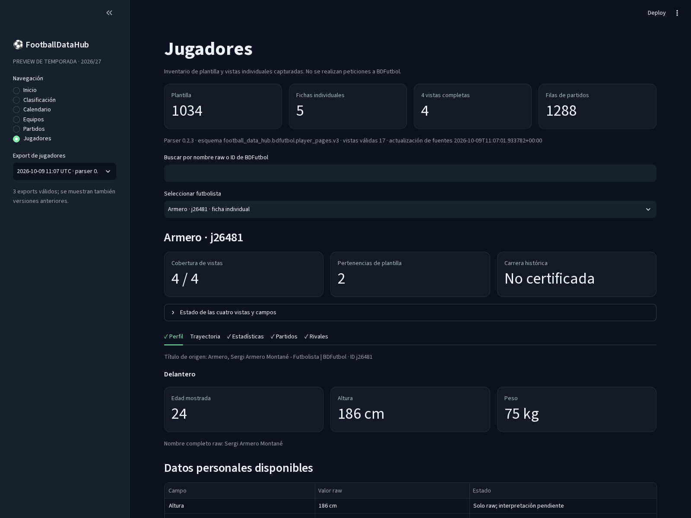
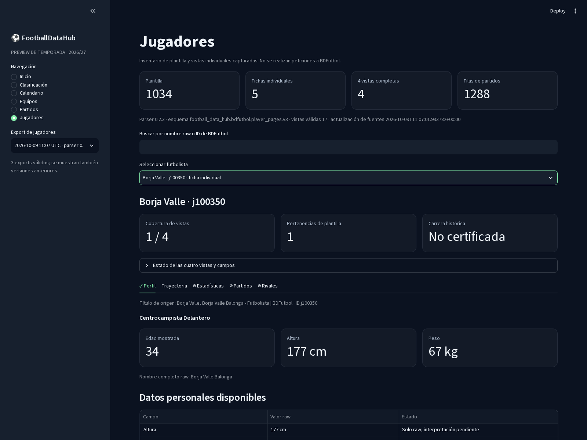
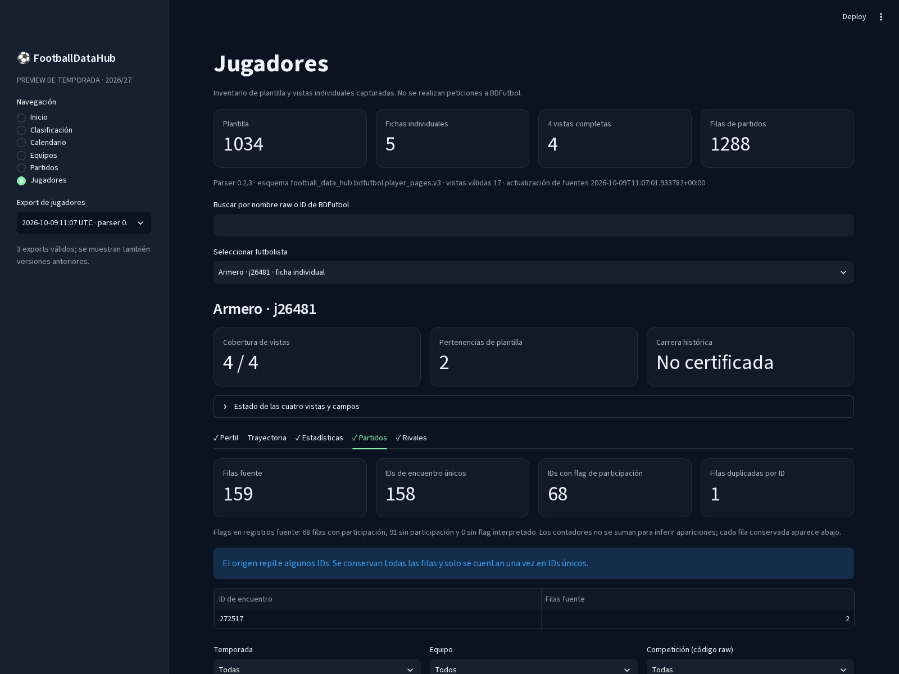

# Hito 1E-B1-L — Jugadores en Dev Explorer

**Fecha:** 9 de octubre de 2026 · **Rama:** `rebuild/football-data-hub-v2`
**Alcance:** integración local y de solo lectura de los exports existentes de jugadores. No se accedió a BDFutbol ni se iniciaron colectores.

## Funcionalidades añadidas

La navegación existente conserva Inicio, Clasificación, Calendario, Equipos, Partidos y Calidad y procedencia, y añade **Jugadores**. Esta pantalla permite buscar por nombre raw o ID entre los 1.034 jugadores del inventario. La selección distingue una ficha individual de un jugador disponible solo en los datos de plantilla; por defecto enfoca primero a quienes sí tienen ficha.

La ficha de cada jugador tiene secciones para:

- **Perfil:** título de origen, datos personales raw disponibles, su estado de interpretación, pertenencias de plantilla, referencias de fotografías y estado de cobertura. Las referencias se muestran como texto; no se descargan imágenes.
- **Trayectoria:** temporadas, equipos, división y tabla original. Se preservan las celdas raw y se destacan temporadas con varias filas sin asumir que sean traspasos. La carrera aparece como no certificada cuando así lo indica el export.
- **Estadísticas:** filas por competición, equipo e hitos deportivos, con valores raw, estado por celda y una inspección de cabeceras, visibilidad y enlaces de origen.
- **Partidos:** filas individuales del export derivadas de `window.P`, con fecha, temporada, competición, jornada, equipos, resultado, estado de participación, minutos raw, ID y URL de origen. Filtros locales por temporada, equipo y código raw de competición.
- **Rivales:** relaciones con jugadores, entrenadores y clubes/equipos, filtro por tipo, búsqueda local y paginación; se pueden inspeccionar las celdas raw de cada fila.

Los contadores de partidos separan filas fuente, IDs de encuentro únicos, IDs con flag de participación y duplicados fuente. La tabla no elimina registros repetidos. Los agregados permanecen en una sección separada y no se convierten en encuentros.

Las vistas sin snapshot se muestran como pendientes y no como tablas vacías de estadísticas. Un campo ausente se diferencia de un campo raw-only. Los exports no certifican que las carreras históricas estén completas; la aplicación tampoco lo hace.

## Datasets y selección

La app descubre exports gzip bajo:

`data/parsed/bdfutbol/player_2026_27/compact/`

Valida metadata, esquema v3, wrappers JSON gzip, lista de registros, recursos y versiones. Elige por defecto el export compatible más reciente según las capturas de origen; permite seleccionar los demás exports compatibles desde el selector lateral. Los exports antiguos de esquemas v1 y v2 se detectan como incompatibles y no se mezclan con el contrato v3.

El export seleccionado por defecto es:

`snapshot-03c756259f97bb953fc9-parser-0.2.3/`

Resumen leído directamente del export: 1.034 jugadores; 5 perfiles individuales; 4 jugadores con las cuatro vistas; 17 vistas individuales capturadas y parseadas; 43 vistas pendientes del piloto; 1.288 filas individuales de partidos; 382 filas de estadísticas; 59 filas de trayectoria y 6.286 registros de rivales. La completitud de carrera está marcada como no certificada.

### Ejemplos de datos actuales

| Jugador | Vistas capturadas | Trayectoria | Filas de partido en el export | Estadísticas / rivales |
|---|---:|---:|---:|---|
| Unai Medina (`j100160`) | 4/4 | 20 filas | 789 registros; 789 IDs; 463 IDs con flag de participación | 102 filas estadísticas; 3.554 relaciones de rivales |
| Borja Valle (`j100350`) | 1/4 | 20 filas | No adquirida; no se muestra como cero partidos | Estadísticas y rivales pendientes |
| Morillas (`j209629`) | 4/4 | 3 filas | 81 registros; 81 IDs; 34 IDs con flag de participación | 97 filas estadísticas; 533 relaciones de rivales |
| Manu Pedreño (`j23751`) | 4/4 | 10 filas | 259 registros; 259 IDs; 107 IDs con flag de participación | 94 filas estadísticas; 1.452 relaciones de rivales |
| Sergi Armero (`j26481`) | 4/4 | 6 filas | 159 registros; 158 IDs; 68 IDs con flag de participación | 89 filas estadísticas; 747 relaciones de rivales |

En Sergi Armero, el ID `272517` aparece en dos filas fuente. La interfaz conserva las dos filas y cuenta ese ID una sola vez entre los encuentros únicos. Las flags de participación son conteos del estado interpretado por el parser; la app no transforma una fila fuente en una aparición semántica adicional.

Las sumas de la tabla son por jugador y no deben agregarse como partidos únicos entre jugadores: un mismo encuentro puede aparecer en más de una trayectoria de jugador.

## Archivos modificados y añadidos

- `src/football_data_hub/dev_explorer/data.py`: descubrimiento y validación de exports gzip v3, carga de los recursos de jugador, selección del export más reciente, filtros y contadores de encuentros sin deduplicar registros.
- `src/football_data_hub/dev_explorer/app.py`: sección Jugadores y vistas deportivas integradas en la aplicación actual.
- `tests/test_dev_explorer_players.py`: fixtures gzip sintéticos y pruebas de versiones de export, fichas completas/parciales, jugador solo de plantilla, campos ausentes/raw-only, duplicados, flags de participación y filtros locales.
- `docs/dev_explorer.md`: navegación, datos de jugador, ejecución y límites actualizados.
- `docs/assets/dev_explorer_players.png`, `docs/assets/dev_explorer_player_partial.png` y `docs/assets/dev_explorer_player_matches.png`: capturas de la app local.
- Este informe.

Los fixtures de las pruebas son sintéticos y están aislados en `tmp_path`; no se agregan al dataset deportivo. No se modificaron scrapers, parsers, snapshots ni exports.

## Ejecución

Desde la raíz del repositorio:

```bash
.venv/bin/python -m pip install -e '.[dev-explorer]'
.venv/bin/streamlit run scripts/run_dev_explorer.py
```

La app abre en `http://127.0.0.1:8502`. La sección Jugadores lee exports del disco local, trabaja offline y es de solo lectura. En esta comprobación el servidor local se detuvo después de guardar las capturas.

## Capturas

Vista de jugador con las cuatro vistas disponibles:



Ficha parcial de Borja Valle: una vista capturada de cuatro, con Estadísticas, Partidos y Rivales pendientes:



Vista Partidos de Sergi Armero: conserva 159 filas, cuenta 158 IDs únicos y señala el ID repetido `272517`:



## Pruebas y comprobaciones

- Pruebas de Dev Explorer de competición y jugadores: **12 passed**.
- Suite completa: **246 passed**.
- AppTest de Streamlit: sin excepciones al cargar la vista de jugador para Sergi Armero (4/4), Borja Valle (1/4) y un jugador solo de plantilla (0/4). La navegación anterior también cargó sin excepciones.
- Ruff sobre `data.py`, `app.py` y sus pruebas: **All checks passed**.
- Ruff global: mantiene seis incidencias preexistentes fuera del hito (`E713` en `scripts/probe_bdfutbol_headless.py` y cinco `F401` en tests de Discovery/Browser Runtime/Browser Session). No se modificaron.
- `git diff --check`: sin errores.

## Límites y mejoras posteriores

Solo hay cinco perfiles individuales en el export actual. Borja puede consultarse con sus datos personales y trayectoria de perfil, pero sus otras tres vistas siguen pendientes por el bloqueo live previo. Los 1.288 registros de partidos corresponden a las capturas de cuatro jugadores y no representan 1.288 apariciones ni necesariamente 1.288 encuentros únicos.

Las celdas cuyo significado no está confirmado permanecen como raw; los códigos de competición de partidos se muestran literalmente. El export conserva enlaces, pero la interfaz los presenta como texto y no abre recursos externos. No se han descargado fotografías ni se han inferido campos ausentes.

Como siguientes mejoras pequeñas, una vez aumente la cobertura, convendría añadir una comparación entre dos exports compatibles y una vista de detalle del partido que una filas de distintos jugadores por ID manteniendo por separado sus participaciones fuente. Ninguna de las dos se implementa en este hito.
